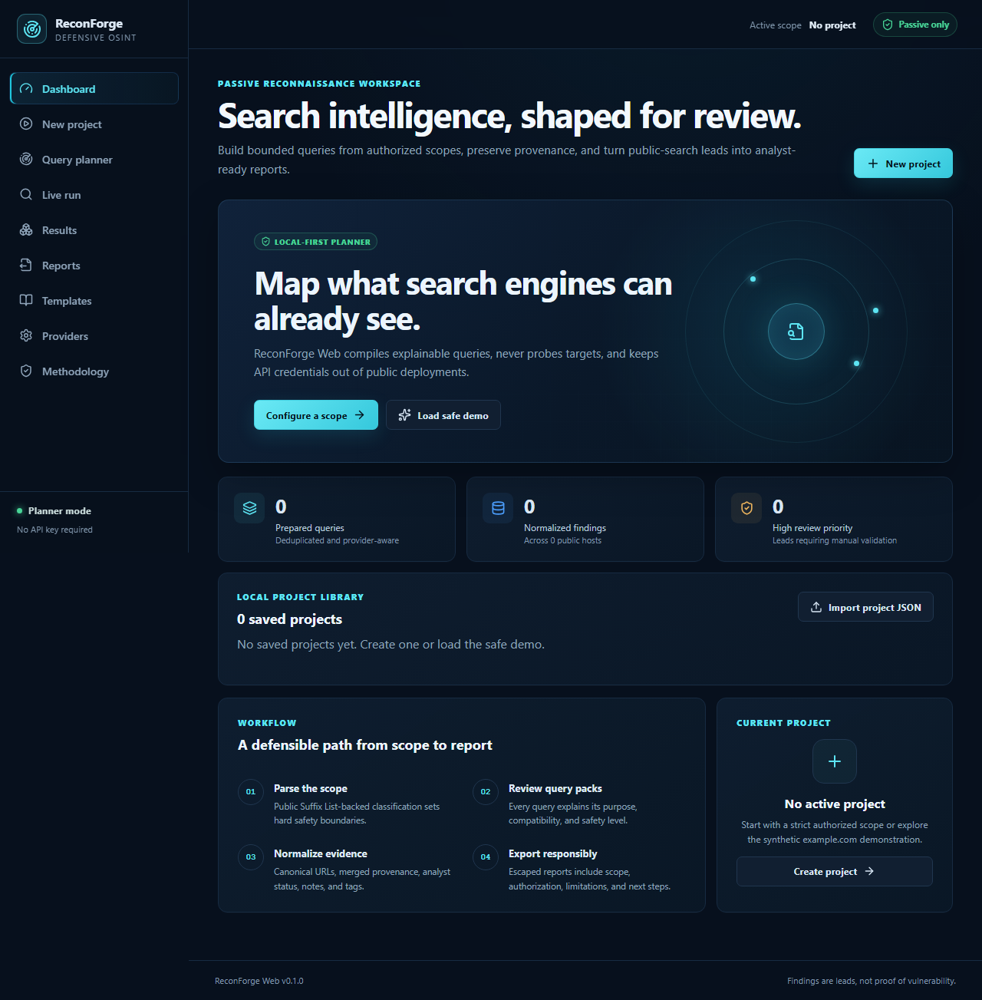
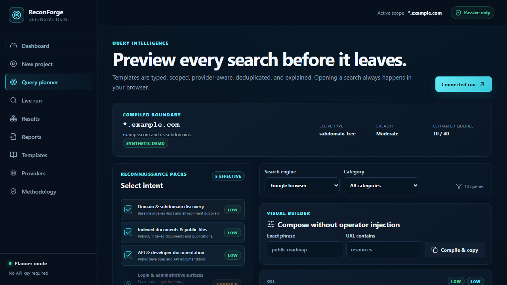
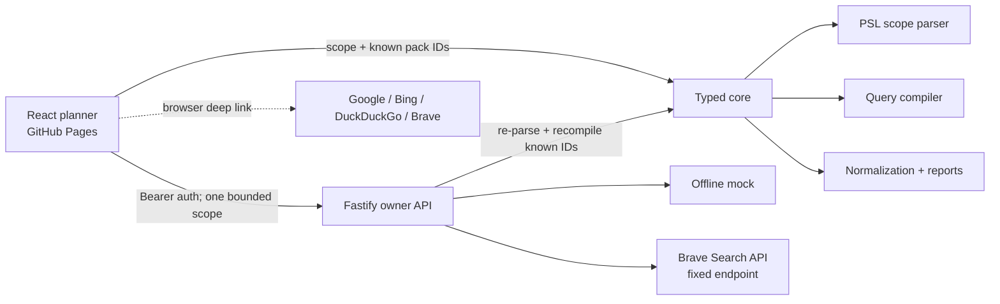
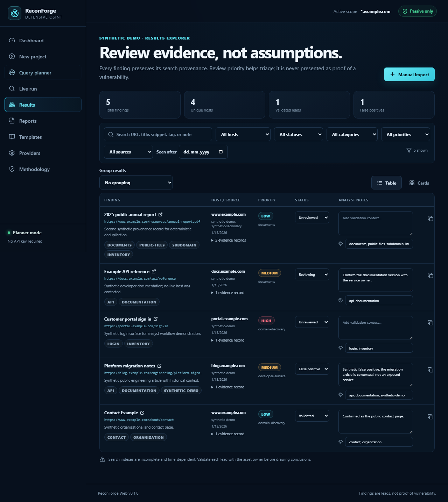
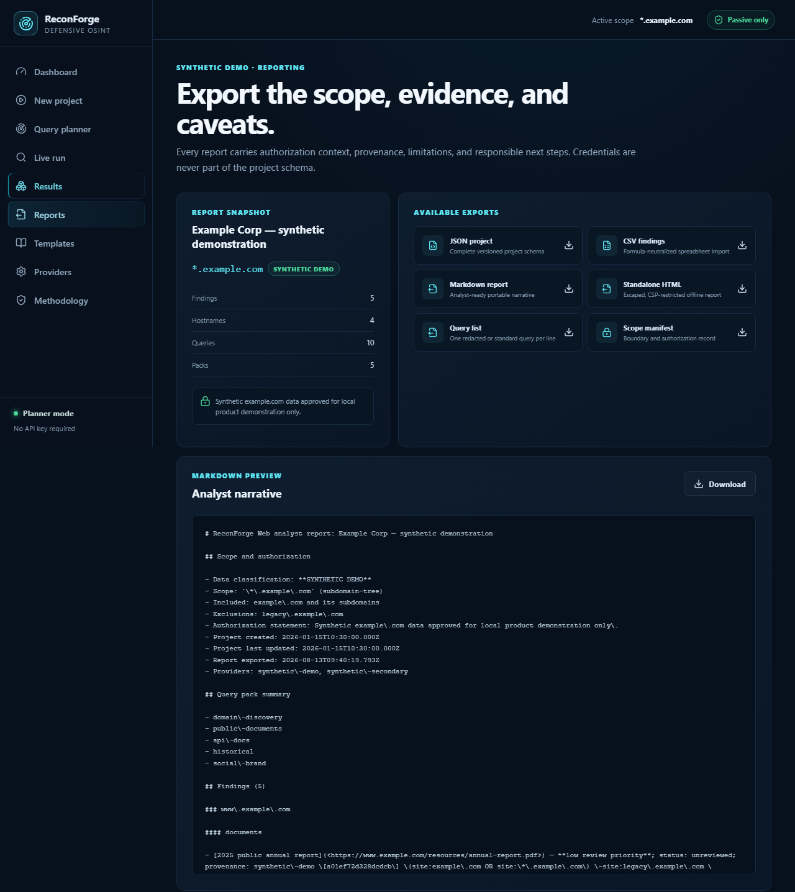

# ReconForge Web


ReconForge Web is a local-first passive reconnaissance planner and analyst workspace for authorized defensive OSINT. It turns a strict domain boundary into explained search queries, normalizes public-result metadata, preserves provenance, supports analyst review, and exports evidence with its authorization context and limitations.

**ReconForge Web does not prove that a discovered page is vulnerable.** A review priority is a triage aid, not a security verdict.

[Try the public planner](https://favi2202.github.io/ReconForge-Web/) · [Read the ethical-use policy](ETHICAL_USE.md) · [Review the threat model](docs/threat-model.md)



## What works in v0.1.0

- Public planner with no API key: strict scopes, 14 typed query packs, explanations, browser search deep links, manual imports, IndexedDB persistence, and six export formats.
- Exact root domain (`example.com`), exact subdomain (`sub.example.com`), subdomain tree (`*.example.com`), public suffix (`*.uz`), and a manual list of up to 25 exact authorized domains.
- Safety-aware compilation: suffix scopes have an eight-query hard cap, low-risk packs only, mandatory preview, no connected execution, and no Sensitive Exposure Review.
- Optional connected owner API: disabled by default, bearer-authenticated, strict CORS, IP and owner quotas, fixed providers, cancellation, timeouts, retry backoff, bounded results, and redacted logs.
- Offline mock provider for the complete run workflow plus an official Brave Search API adapter.
- Results table with host/source/category/date/priority filters, canonical-URL deduplication, per-host context, notes, tags, analyst status, false-positive marking, timestamps, and safe links.
- JSON, formula-safe CSV, Markdown, escaped standalone HTML, query-list, and scope-manifest exports.
- Synthetic `example.com` demonstration, first-run tour, responsive layouts, keyboard focus states, and automated WCAG checks.



## Operating modes

| Mode                | Where it runs              | Credentials                                          | Capabilities                                                                                                           |
| ------------------- | -------------------------- | ---------------------------------------------------- | ---------------------------------------------------------------------------------------------------------------------- |
| **Public planner**  | Static browser application | None                                                 | Parse scopes; generate, explain, preview, copy, export, and open individual queries; import and review results locally |
| **Connected owner** | Separate API service       | Owner bearer token plus optional server provider key | Bounded official-provider collection with progress, cancellation, quotas, and server-side scope/template enforcement   |

The public GitHub Pages build cannot spend a private provider quota: it contains no provider credential and has no anonymous search proxy. An operator must independently deploy the API and configure the browser session to use it.

## Scope semantics

| Input                           | Meaning                          | Safety behavior                                                                                          |
| ------------------------------- | -------------------------------- | -------------------------------------------------------------------------------------------------------- |
| `example.com`                   | Exact hostname only              | Narrow; guarded packs available after confirmation                                                       |
| `sub.example.com`               | Exact subdomain only             | Narrow; does not silently expand to siblings                                                             |
| `*.example.com`                 | Root plus its subdomain tree     | Moderate; broader inventory query syntax                                                                 |
| `*.uz`                          | Public-suffix-wide planner scope | Eight-query cap; low-risk packs only; preview required; connected/sensitive disabled                     |
| Multiple lines of exact domains | Explicit authorized list, max 25 | Planner compiles each exact domain with a 100-query global cap; connected runs stay one domain at a time |

Classification uses [`tldts`](https://github.com/remusao/tldts) and the maintained Public Suffix List data it ships, not string splitting.

## Passive discovery versus active validation

ReconForge performs **passive discovery**: it creates search queries, opens a selected search engine in the analyst's browser, or retrieves bounded search-result metadata through an official API. It does not contact discovered result pages.

**Active validation** includes visiting an application to test behavior, scanning ports, trying credentials, exploiting a weakness, crawling content, or retrieving exposed files. Those activities are deliberately outside this project and require a separate authorized process.

## Quick start

Requirements: Node.js 24 LTS and npm 11 or later.

```bash
git clone https://github.com/favi2202/ReconForge-Web.git
cd ReconForge-Web
npm ci
npm run dev
```

Open `http://localhost:5173`. Choose **Load safe demo** to explore without a real target.

Run the verified quality suite:

```bash
npm run format:check
npm run lint
npm run typecheck
npm run test:coverage
npm run build
npm run test:e2e
```

More detail is in the [quick-start guide](docs/quick-start.md).

## Connected owner mode

Copy `.env.example` to `.env`, generate a strong application access token, and enable the service:

```bash
# Generate a token first:
node -e "console.log(require('node:crypto').randomBytes(32).toString('hex'))"

CONNECTED_MODE=true
APP_ACCESS_TOKEN=
CORS_ALLOWLIST=http://localhost:5173
BRAVE_SEARCH_API_KEY=
```

Paste the generated token after `APP_ACCESS_TOKEN=`. Known placeholder and low-diversity values are rejected at startup.

Start locally with `npm run dev:api`, or with the hardened Compose configuration:

```bash
docker compose up --build
```

In **Provider settings**, enter `http://127.0.0.1:8787` and the application token. The browser stores this token in `sessionStorage`, never in the project or IndexedDB. Remote owner APIs must use HTTPS.

See [provider configuration](docs/providers.md) and [deployment](docs/deployment.md) for all settings.

## Architecture



The monorepo is intentionally small:

- `apps/web`: React, TypeScript, Vite, hash routing, IndexedDB.
- `apps/api`: stateless Fastify service; in-memory bounded run state.
- `packages/core`: schemas, scope parser, query compiler, normalization, grouping, imports, and reporting.
- `packages/templates`: versioned query packs and template metadata.

The API has no arbitrary URL-fetch endpoint and no raw-query endpoint. It receives a scope and stable template IDs, parses and classifies the scope again, selects catalog templates, applies caps, and calls a fixed provider adapter.

Read the full [architecture](docs/architecture.md) and [threat model](docs/threat-model.md).

## Security posture

- Strict Zod schemas and byte/count limits for imports and API bodies.
- Per-IP and per-owner fixed-window quotas; query/result hard caps.
- Bearer-token comparison with constant-time equality.
- CSP, Helmet security headers, exact CORS allowlist, safe `noopener noreferrer` links.
- Plain-text rendering for provider snippets; escaped standalone HTML.
- Spreadsheet-formula neutralization for every CSV cell.
- Fixed provider hosts, provider timeouts, bounded retries, AbortSignal cancellation.
- Recursive logger redaction for authorization, provider keys, results, and snippets.
- Public-suffix connected collection disabled.

Please report vulnerabilities through the process in [SECURITY.md](SECURITY.md). Do not include live credentials or third-party sensitive data in a report.

## Exports and schema

JSON exports use schema version `1.0`. The root object contains project identity, authorization statement, primary and optional additional scopes, selected pack IDs, compiled queries, normalized findings, and timestamps. Each finding carries canonical URL, hostname/root domain, category, review priority, analyst status, notes, tags, and one or more provenance records (`provider`, redacted/standard query, query ID, collection timestamp).

The v0.1 UI supports validated project-JSON import plus scoped manual URL-result import. Project files are capped at 5 MB and 5,000 findings, with strict unknown-key rejection and server-derived scope authority.



<p align="center">
  
</p>



## Documentation

- [Quick start](docs/quick-start.md)
- [Architecture](docs/architecture.md)
- [Provider configuration](docs/providers.md)
- [Query template authoring](docs/template-authoring.md)
- [Export schema](docs/export-schema.md)
- [Deployment](docs/deployment.md)
- [Research comparison](docs/research.md)
- [Threat model](docs/threat-model.md)
- [Ethical use](ETHICAL_USE.md)
- [Security and disclosure](SECURITY.md)
- [Contributing](CONTRIBUTING.md)

## Known limitations

- Search indexes are incomplete and time-dependent; browser results may differ by region and session.
- Brave Search is the only live connected search adapter in v0.1; Google, Bing, and DuckDuckGo are browser deep links.
- Connected run state and quotas are in memory, appropriate for a single-instance owner service. Multi-instance deployments need a shared trusted limiter/run store.
- Manual lists are planner-only for connected collection so each exact domain has an independent authorization and budget decision.
- IndexedDB projects remain in the current browser profile unless exported.
- Provider snippets are metadata only; ReconForge does not download or actively validate result pages.

## License

Original project code is MIT licensed. See [LICENSE](LICENSE) and [third-party notices](THIRD_PARTY_NOTICES.md). No external dork/query database was copied into this repository.
