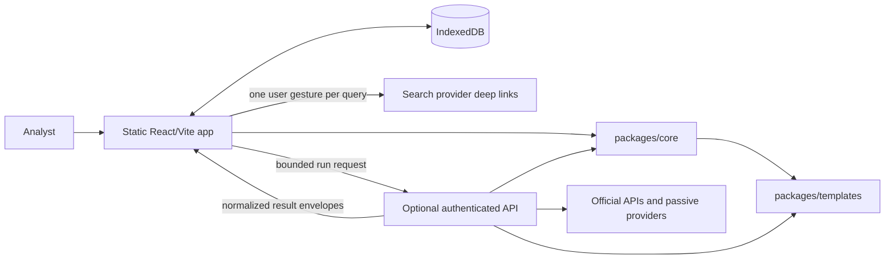
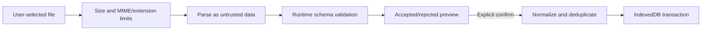

# ReconForge Web product and UX architecture

- Status: implementation blueprint, updated for v0.2.0
- Primary client: React + TypeScript + Vite
- Primary deployment: static GitHub Pages planner, optional independently deployed owner API

## 1. Product model

ReconForge Web is a local-first reconnaissance planner and analyst workspace. The planner is the product baseline, not a degraded connected mode: it parses an authorized scope, compiles explained queries, opens individual browser searches, imports analyst-provided results, normalizes findings, and creates reports without an account or API key.

Connected owner mode adds one capability: executing a bounded plan through an authenticated server adapter. It does not unlock alternate templates, expand scope, or move the project database to the server. The browser remains the system of record for projects, annotations, findings, and report snapshots.

Use the term **review priority** everywhere. A result is a lead for manual validation, never proof of a vulnerability.

### Product principles

1. **Scope before search.** Every workflow starts with a parsed scope manifest and visible exclusions.
2. **Preview before execution.** The exact compiled query list and estimated budget are reviewable before opening links or starting a connected run.
3. **Provenance everywhere.** Each finding retains provider, query/template, timestamps, and import/run origin.
4. **Local by default.** Planner projects never leave the browser unless the analyst exports them or explicitly starts a connected run.
5. **Capability, not environment, drives UI.** Unavailable connected actions are clearly explained; planner actions remain usable.
6. **Dense but calm.** The interface supports analyst-scale data without decorative charts or alarmist severity language.

## 2. Runtime topology



Recommended monorepo responsibilities:

- `apps/web`: application shell, routes, interaction state, IndexedDB repositories, imports/exports, deep links, and authenticated API client.
- `apps/api`: authentication, capability discovery, run admission, quotas, provider adapters, timeouts, cancellation, and secret-safe logging.
- `packages/core`: runtime schemas, scope parsing, query compilation, normalization, deduplication, priority calculation, import validation, and report serialization. It has no React or server-framework dependency.
- `packages/templates`: versioned, reviewed query packs and provider syntax metadata. No credentials and no runtime networking.
- `packages/ui`: only reusable visual primitives and tokens once there are at least two real consumers. Keep feature components in `apps/web`.

The web build must function with `VITE_CONNECTED_API_BASE_URL` unset. The public GitHub Pages build should leave it unset. There must be no provider keys, owner tokens, or secret-shaped placeholders in the web bundle.

## 3. Information architecture and routes

The shipped application uses a persistent shell and compact hash routes. Project selection belongs to the IndexedDB-backed project library, so routes stay stable when switching projects and direct refreshes work under the GitHub Pages repository subpath. Route labels below omit the deployment base; the actual static URL is `/#/...`.

| Route        | Page purpose                                                                                | Primary action          |
| ------------ | ------------------------------------------------------------------------------------------- | ----------------------- |
| `/`          | Dashboard, local project library, local counts, mode status, import, and safe demo entry    | Open/new project        |
| `/new`       | Name a project, record authorization, parse scope/list/exclusions, and preview restrictions | Create and plan         |
| `/planner`   | Select packs, inspect/deduplicate queries, review budget and restrictions                   | Save plan / run options |
| `/run`       | Start or resume a bounded connected run, show progress, cancellation, and partial results   | View results            |
| `/results`   | Filter, group, inspect, annotate, tag, and mark false positives                             | Create report           |
| `/reports`   | Preview and download six report/export formats                                              | Export report           |
| `/templates` | Search and inspect the read-only built-in template library                                  | Review restrictions     |
| `/settings`  | Explain browser providers and configure an optional API URL/access token                    | Test connection         |
| `/about`     | Architecture, methodology, limitations, ethical use, and passive-versus-active explanation  | Read ethical-use policy |

The project overview is a resumable workflow, not a marketing dashboard. Its ordered steps are Scope, Plan, Collect, Review, Report. Each step has `not started`, `needs attention`, `ready`, or `complete` state derived from data rather than independently stored.

Unknown projects and malformed imports get dedicated recovery pages. A route error must preserve the shell and offer Dashboard and Back actions.

### Navigation

- Desktop (at least 1024 px): 248 px left navigation, compact top bar, main content with a readable maximum width on forms and full width on results.
- Tablet: collapsible rail with labels available on focus/hover and a full-width main area.
- Mobile: top app bar plus an explicit menu drawer; project steps become a horizontally scrollable labelled step list. Do not rely on icons alone.
- Global mode badge says `Planner` or `Connected: <provider count>`. It reports capability; it is not a toggle that silently changes behavior.
- Project name, normalized scope, and demo status stay visible in project routes.

## 4. Core user journeys

### First run and synthetic demonstration

The empty Dashboard presents two equally clear options: **Create project** and **Explore safe demo**. A short, dismissible guided tour highlights Scope, Planner, Results, and Reports. The tour must never block keyboard navigation or reappear after dismissal.

The demo is generated locally from a versioned fixture and makes no network requests. It should contain:

- A project called `Example Organization exposure review`.
- A manual authorized list containing reserved names such as `example.com`, `www.example.com`, and `api.example.com`.
- A scope manifest, a compiled low-risk query plan, a completed mock run, intentional cross-provider duplicates, varied categories/priorities, annotations, a false positive, and a partial-provider warning.
- Clearly fabricated `example.com` URLs and snippets only; no real third-party targets.
- A persistent `SYNTHETIC DEMO` badge on every project page and exported report.

Use fixed fixture timestamps and stable IDs so screenshots and end-to-end tests are deterministic. A `Reset demo` action replaces only the demo project after confirmation. Simulated progress may be used when replaying the demo, but it must be labelled `Simulation` and be cancellable.

### Create and scope a project

1. Ask for project name and a required authorization checkbox/statement before any restricted templates can be enabled.
2. Accept one scope per line. Never accept URLs, paths, query strings, ports, IP addresses, or wildcard placement other than a leading `*.`.
3. Parse on blur and after a short debounce; confirm only after full runtime validation.
4. Present original value, normalized value, scope type, included hostnames, exclusions, provider-specific syntax, expected breadth, and query estimate.
5. For suffix scope, show a persistent warning panel, reduced hard-limit summary, and a confirmation step. Sensitive and exact-domain-only packs remain absent or disabled with a reason.
6. Changing a confirmed scope marks the current plan stale. It does not silently rewrite or discard prior run evidence.

### Plan and collect

The Planner uses a pack list on the left and a query preview on the right at desktop widths; mobile uses sequential Pack and Preview sections. The budget summary is sticky within the content area.

Every generated item displays template name, intent, provider compatibility, safety level, review priority, and compiled query. Equivalent queries collapse into one row while retaining all contributing template IDs. Unsafe or unsupported operator input is rejected inline before it becomes a query.

Collection choices are explicit:

- **Open query**: opens one selected browser-provider deep link from a direct user gesture with `noopener,noreferrer`.
- **Copy/export queries**: planner-only and always available.
- **Import results**: accepts validated supported formats and previews accepted/rejected rows before committing.
- **Run with connected providers**: only visible as an enabled primary action after capability and authorization checks. Otherwise it is a disabled action with a short setup explanation.

Never offer `Open all`. It creates popup, provider-policy, and accidental broad-query problems.

### Review results

Results Explorer defaults to a table on larger screens and cards on narrow screens. Its persistent summary uses textual counts: total unique findings, hosts, sources, needs-review, reviewed, false positive. Do not invent time-series or distribution charts without data that answers an analyst question.

Filters are encoded in URL search parameters so Back/Forward and copied local links retain the current view. Persist only sensible view preferences (table/card, page size); do not persist transient search text globally.

Selecting a result opens a details drawer on desktop and a full-screen sheet on mobile. It includes escaped snippet text, canonical URL, copyable hostname/indicator, provenance list, evidence timestamps, notes, tags, analyst status, and safe outbound link. Cross-provider duplicates appear as multiple provenance entries, not separate findings.

Bulk actions are limited to status, tag, and false-positive changes. Selection count and the affected scope are announced before applying.

### Report

The report page previews included scope, authorization statement, provider/query summaries, groupings, limitations, and analyst notes. Exports are generated locally from a frozen snapshot and validated through shared core schemas. Each download shows format, approximate row count, and whether snippets are included. HTML is standalone and escaped; CSV values are formula-neutralized.

## 5. UI composition

Suggested feature-oriented component tree:

```text
AppProviders
└── Router
    └── AppShell
        ├── SkipLink
        ├── PrimaryNavigation
        ├── TopBar / ModeBadge
        ├── RouteAnnouncer
        └── RouteOutlet
            ├── DashboardPage
            ├── ProjectLayout
            │   ├── ProjectHeader
            │   ├── WorkflowSteps
            │   └── ProjectRouteOutlet
            │       ├── ScopePage
            │       ├── PlannerPage
            │       ├── RunPage
            │       ├── ResultsPage
            │       └── ReportsPage
            ├── TemplateLibraryPage
            ├── ProviderSettingsPage
            └── AboutPage
```

Feature components should consume typed application services, not call IndexedDB or `fetch` directly. Examples are `useProject(projectId)`, `useCompilePlan()`, `useResultFilters()`, and `useConnectedRun()`. Visual primitives should not know domain rules.

Recommended client libraries, subject to dependency review:

- React Router for route ownership and search parameters.
- Dexie for IndexedDB migrations and transactional repositories.
- React Hook Form plus the shared runtime schemas for form validation.
- TanStack Table for accessible table state and optional row virtualization only after measurement.
- TanStack Query for optional API capability/run requests; do not use it as the local project database.
- A small toast implementation for supplemental feedback only. Durable failures remain inline.

Avoid a broad global state store initially. Route state belongs in the URL; durable domain state belongs in repositories; form state belongs in the form; connected server state belongs in the query client. A small React context may hold connection status, ephemeral access token, theme, and tour state.

## 6. Domain state and persistence

Persist versioned records in IndexedDB:

```text
Project
  id, name, createdAt, updatedAt, authorization, demo, activeScopeRevisionId
ScopeRevision
  id, projectId, originalInputs, manifest, warnings, createdAt
QueryPlan
  id, projectId, scopeRevisionId, templateCatalogVersion, items, estimate, createdAt
Run
  id, projectId, queryPlanId, kind, status, providerStates, startedAt, finishedAt
Finding
  id, projectId, fingerprint, canonicalUrl, hostname, rootDomain, category,
  reviewPriority, firstSeenAt, lastSeenAt
Provenance
  id, findingId, runId, providerId, queryId, observedUrl, snippet, observedAt
Annotation
  findingId, status, note, tags, updatedAt
ReportSnapshot
  id, projectId, schemaVersion, filters, findingIds, createdAt
Preference
  key, value
```

`Finding.fingerprint` is derived from canonical URL and scope-safe normalization. Annotations are separate so re-importing or deduplicating evidence does not erase analyst work. Scope and plan revisions are immutable references for historical runs; only the active revision pointer changes.

Use repository interfaces such as `ProjectRepository`, `FindingRepository`, and `RunRepository`. A schema migration must be transactional. Before destructive migration failure, keep the old database intact and offer a validated JSON export/recovery path.

Import flow is stage-then-commit:



Never render imported or provider strings as HTML. Preserve raw observed values only where required for provenance; all UI rendering uses text nodes.

## 7. Planner versus connected mode boundary

| Concern                 | Public planner                    | Connected owner mode                                                                                             |
| ----------------------- | --------------------------------- | ---------------------------------------------------------------------------------------------------------------- |
| Availability            | Always, static-only               | Opt-in API URL plus valid owner access token                                                                     |
| Secrets                 | None                              | Provider keys and quota configuration only on server                                                             |
| Project/results storage | Browser IndexedDB                 | Browser IndexedDB; API keeps only short-lived run state                                                          |
| Query compilation       | Browser via shared core/templates | Server recompiles and revalidates the requested template IDs and scope                                           |
| Search                  | One browser deep link per gesture | Only configured official adapters; never arbitrary URL fetch/search proxy                                        |
| Authentication          | None                              | `Authorization: Bearer` owner token; token kept in memory by default, session storage only after explicit opt-in |
| Scope controls          | Full parsing and UI restrictions  | Same checks repeated server-side; server limits are authoritative                                                |
| Quotas                  | Query estimate and safe UI caps   | Per-token and per-IP admission limits plus provider budgets                                                      |
| Reports                 | Local                             | Local after normalized envelopes return                                                                          |

Do not send an arbitrary compiled query as authority to the API. A connected request should contain a schema-versioned scope manifest, selected stable template IDs, provider IDs, and authorization-attestation metadata. The API parses the original normalized scopes again, loads its own template catalog, applies the stricter of UI/server limits, compiles the plan, and rejects mismatched versions or disallowed templates. Custom visual-builder queries should remain browser deep links in v1 unless the server has a narrowly validated AST-to-query compiler.

Suggested API surface:

- `GET /v1/capabilities`: unauthenticated or minimally revealing; returns API version, auth required, enabled provider IDs, supported scope types, and public numeric limits. Never returns secret configuration.
- `POST /v1/session/verify`: verifies the owner token and returns authenticated capabilities; no token echo.
- `POST /v1/runs`: admits a bounded run and returns `202 { runId }`.
- `GET /v1/runs/:runId`: authenticated progress and normalized result batches, capped and retained for a short TTL.
- `DELETE /v1/runs/:runId`: authenticated idempotent cancellation.

The web polls a live run with bounded backoff and an `AbortController`; route exit stops polling but does not imply cancellation. The run page explicitly offers Cancel. A browser refresh can resume while the short-lived API job exists. Results already received remain usable when a provider partially fails or the job expires.

Client connection state is a small state machine:

```text
planner-only -> probing -> authentication-required -> connected
                         \-> unavailable
connected -> expired -> authentication-required
```

No automatic fallback from a failed connected run to opening browser searches. Show the failure, retain partial results, and let the analyst choose the next action.

## 8. Visual system

Use system fonts to avoid third-party font requests. Suggested tokens should be checked with automated contrast tooling before finalizing:

| Token            | Suggested value | Use                                                  |
| ---------------- | --------------- | ---------------------------------------------------- |
| `--bg-canvas`    | `#07111F`       | App background                                       |
| `--bg-surface`   | `#0D1A2B`       | Cards and navigation                                 |
| `--bg-raised`    | `#14243A`       | Drawers, menus, hover                                |
| `--border`       | `#29405C`       | Boundaries                                           |
| `--text-primary` | `#E7F0FA`       | Primary text                                         |
| `--text-muted`   | `#A7B8CC`       | Secondary text                                       |
| `--accent`       | `#35C2E8`       | Links and primary focus                              |
| `--focus`        | `#7DD3FC`       | 2–3 px focus ring with offset                        |
| `--success`      | `#4ADE80`       | Completed/success with icon and text                 |
| `--warning`      | `#FBBF24`       | Broad scope/partial state with icon and text         |
| `--danger`       | `#FB7185`       | Validation/destructive actions, never finding “risk” |

Use an 8 px spacing rhythm, 10–12 px radii, restrained shadows, and tabular numerals for counts. Monospace is reserved for scopes, queries, URLs, and IDs. Motion should be short and functional; progress changes should not cause layout shifts.

Review priority uses labelled neutral chips (`Low`, `Normal`, `Elevated`, `Urgent review`) with an icon or shape as well as color. It must never be labelled vulnerability severity.

## 9. Responsive behavior

Design from narrow viewports upward and verify at approximately 360, 768, 1024, and 1440 px.

- Forms are single-column until there is enough room for a stable summary rail.
- Results table changes to result cards below 768 px; do not squeeze every column into a horizontal table. Cards retain hostname, category, priority, source count, status, and detail action.
- Filters become a modal sheet with an always-visible active-filter count and `Apply`/`Clear` actions. Desktop filters update immediately.
- Detail drawers become full-screen sheets on mobile and return focus to the invoking row/card on close.
- Sticky controls must not cover content or the on-screen keyboard. Respect safe-area insets.
- Query strings and URLs wrap or scroll inside their own containers; they never widen the page.
- Touch targets are at least 44 by 44 CSS pixels and adjacent destructive actions are separated.

## 10. Accessibility requirements

Target WCAG 2.2 AA for the core workflow.

- Include a first-focus skip link and semantic `nav`, `main`, headings, tables, forms, and status regions.
- Move programmatic focus to the route heading after client-side navigation and announce the new page name through a restrained route announcer.
- Every input has a persistent label, helpful description where needed, and an inline error connected with `aria-describedby`. Do not use placeholder-only labels.
- Keyboard users can reach every action in logical DOM order. Rows are not click-only; use actual buttons/links inside them.
- Modal dialogs trap focus only while open, close on Escape when safe, and restore trigger focus. A destructive unsaved state requires confirmation.
- Live run updates use a throttled `aria-live="polite"` summary; do not announce every result. Cancellation and terminal failures use a concise assertive message.
- Progress has text (`12 of 40 queries`) in addition to a bar. Indeterminate state is explicitly labelled.
- Status, category, and priority never rely on color alone.
- Honor `prefers-reduced-motion`; disable skeleton shimmer and nonessential transitions.
- Tooltips are supplemental. All necessary explanations are available as visible text or focusable disclosure content.
- Provide a visible focus indicator with sufficient contrast on every interactive surface.

Automated accessibility checks should cover routes and major states, followed by keyboard-only and screen-reader smoke tests for create project, confirm scope, compile plan, import, annotate, and export.

## 11. State and error design

Each route must deliberately implement these states:

- **Loading:** use stable skeleton geometry only for real async work; local compilation should usually show immediate progress text.
- **Empty:** explain why no data exists and provide one primary next action.
- **Disabled:** state the unmet condition next to the control (scope not confirmed, broad scope restriction, API unavailable, or authorization missing).
- **Partial success:** preserve findings, name failed providers, and offer retry only for safe bounded subsets.
- **Error:** show a human summary, safe diagnostic code, and recovery action. Never expose headers, tokens, raw stack traces, or full sensitive snippets.
- **Offline:** planner remains usable. Connected controls state that the API cannot be reached without implying local data loss.
- **Stale plan:** show which scope/template revision changed and require recompilation before connected execution.

Toasts confirm short reversible actions such as copying. Validation, import rejection, provider failure, quota exhaustion, and report errors stay visible in page context.

## 12. Implementation slices

Build vertically so each slice is demonstrable and testable:

1. Shell, tokens, routes, accessibility foundation, IndexedDB migration, and synthetic demo.
2. Project creation and strict scope configuration with broad-scope safety states.
3. Template browser, pack selection, query compilation, explanation, deduplication, and export.
4. Manual import pipeline and Results Explorer with provenance and annotations.
5. Local report snapshots and all export formats.
6. Connected capability/auth settings, mock provider, bounded runs, progress, cancellation, and partial failure.
7. Guided tour, responsive polish, empty/error states, visual regression checks, and documentation screenshots.

This order keeps planner mode shippable throughout and makes the connected boundary a narrow, reviewable addition.

## 13. UX acceptance checks

A release candidate is not visually complete until these scenarios have been inspected in both desktop and mobile viewports:

- First visit with no projects.
- Synthetic demo, including obvious demo labelling.
- Invalid scope and corrected scope.
- Broad `*.uz` scope with disabled restricted packs and reduced limits.
- Query plan with duplicates and an unsupported provider.
- Manual import with accepted and rejected rows.
- Live mock run, cancellation, quota error, timeout, and partial-provider success.
- Empty results, dense results, long URLs/snippets, filter combinations, and result detail.
- Report preview and each download action.
- API unavailable, invalid/expired token, and public planner build with no API URL.
- Keyboard-only traversal and reduced-motion mode.
